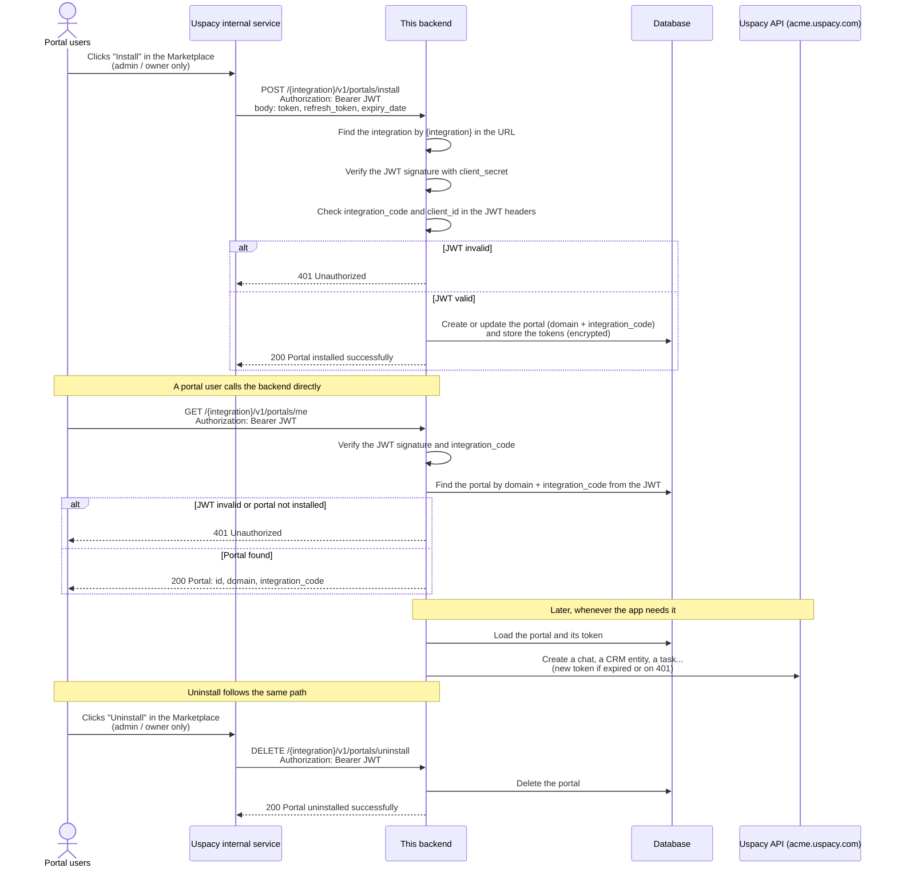

# Uspacy App Template (Laravel)

A starter backend for building an app for the [Uspacy](https://uspacy.com) CRM. It already does the parts every app needs:

- **Install and uninstall.** It keeps a record for each Uspacy portal that installs your app.
- **Calling the Uspacy API.** It calls the API on behalf of a portal (to create chats and messages, CRM entities, tasks, activities and more) and refreshes the access token automatically.
- **Webhooks.** It receives Uspacy events through an AWS SNS subscription.

Requires PHP 8.4 and Composer.

## How it works

1. **Registration.** The Uspacy team registers your app on request. See [Registering your app](#registering-your-app). After that, the app appears in the Uspacy Marketplace.
2. **Install.** A portal admin or owner clicks **Install** in the Marketplace. Uspacy's internal service then calls this backend at `POST /{integration}/v1/portals/install`. The request carries a JWT signed with your `client_secret`, plus the portal's API tokens. The backend checks the JWT and saves the portal along with its tokens.
3. **Work.** With the saved token, the backend calls the Uspacy API on the portal's behalf. It can do whatever your app needs, for example create chats and messages, CRM entities, tasks and activities. A new token is fetched automatically, in two cases: before a request, if the stored token has already expired, and when the API returns `401`, after which the request is retried with the new token. Each new token is saved back to the portal.
4. **User requests.** A portal user can also call this backend directly, for example `GET /{integration}/v1/portals/me`. The request carries a JWT signed with your `client_secret`. The backend finds the portal from the JWT, so the handler knows which portal the request is for.
5. **Events (optional).** If your app is subscribed to webhooks, Uspacy sends events through AWS SNS to `POST /{integration}/v1/uspacy/webhooks`. See [Webhooks](#webhooks).
6. **Uninstall.** A portal admin or owner clicks **Uninstall**. Uspacy's internal service calls `DELETE /{integration}/v1/portals/uninstall`, and the backend deletes the portal.



## Registering your app

You can't register an app in Uspacy yourself: you contact the Uspacy team and ask them to do it.

1. **Choose an integration code**, for example `my-app`. It identifies your app and must be the same in every environment.
2. **Stage first.** The Uspacy team registers the app on the Stage (test) environment and sends you a `client_id` and `client_secret` for Stage.
3. **Then production.** Production gets its own `client_id` and `client_secret`. The integration code stays the same.
4. **Send the URLs** of your backend for each environment: `install` and `uninstall` are required, and the webhook URL is needed only if you want [webhooks](#webhooks). See [Endpoints](#endpoints).

Once registered, the app is listed in the Marketplace, where portal admins and owners can install it.

## Quick start

```bash
composer setup        # installs dependencies, creates .env, generates the app key and runs migrations
php artisan serve     # http://localhost:8000
```

Put your app's credentials in `.env` (see [Registering your app](#registering-your-app)). Each environment has its own `.env`: Stage uses the Stage credentials, production uses the production ones, and the integration code is the same in both:

```dotenv
USPACY_EXAMPLE_INTEGRATION_CODE=example
USPACY_EXAMPLE_CLIENT_ID=...
USPACY_EXAMPLE_CLIENT_SECRET=...
```

## Endpoints

Every URL starts with the integration key, then the API version:

| Method | URL | Called by | Purpose | Required |
|---|---|---|---|---|
| `POST` | `/{integration}/v1/portals/install` | Uspacy internal service | App installed on a portal | **Yes** |
| `DELETE` | `/{integration}/v1/portals/uninstall` | Uspacy internal service | App removed from a portal | **Yes** |
| `GET` | `/{integration}/v1/portals/me` | Portal user | The current portal | No |
| `GET` | `/{integration}/v1/crm/deals` | Portal user | Example: first 10 CRM deals of the portal | No, example |
| `POST` | `/{integration}/v1/uspacy/webhooks` | AWS SNS | Example webhook receiver (logs messages only) | No, example |

Uspacy needs only `install` and `uninstall`. The CRM deals and webhook routes are examples: replace them with your own app's logic, or delete them.

`{integration}` is a key in [config/uspacy.php](config/uspacy.php), for example `example-integration`. When you ask the Uspacy team to register your app, send them URLs like these (one set for Stage, one for production):

```
https://your-server.com/example-integration/v1/portals/install
https://your-server.com/example-integration/v1/portals/uninstall
https://your-server.com/example-integration/v1/uspacy/webhooks
```

## Calling the Uspacy API

Use [uspacy-php-sdk](https://github.com/Uspacy/uspacy-php-sdk) through `UspacySDKFactory`. It signs in with the portal's tokens and refreshes them on its own:

```php
$sdk = app(UspacySDKFactory::class)->fromPortal(\portal());

// CRM
$deals = $sdk->crmDeals()->getEntities(['page' => 1, 'list' => 10]);
$deal = $sdk->crmDeals()->createEntity(['title' => 'New deal']);

// Tasks
$tasks = $sdk->tasks()->getTasks(['page' => 1]);
$task = $sdk->tasks()->createTask(['title' => 'Call the client', 'responsibleId' => 7]);

// Messenger
$chats = $sdk->messenger()->getChats(['status' => 'active']);
$sdk->messenger()->createMessage(['chatId' => $chats[0]->id, 'text' => 'Hello']);
```

See the SDK's [README](https://github.com/Uspacy/uspacy-php-sdk#readme) for all services and payloads. A working example is `CrmDealsController`.

## Webhooks

Your app gets webhooks only after it is subscribed to them. You can't subscribe from the app or through an API: you ask the Uspacy team, and they set up the subscription by hand on their side. Ask for each type you need separately. The types are:

- `crm`
- `tasks`
- `messenger`
- `news_feed`

The example webhook route works for `example-integration` only (`whereIn('integration', [...])` in [routes/api.php](routes/api.php)). This is on purpose: one backend can serve several integrations, and some of them may not receive webhooks at all. To turn webhooks on for another integration, add its key to that list.

## Adding another integration

One deployment can serve several Uspacy apps:

1. Add an entry to `integrations` in [config/uspacy.php](config/uspacy.php). Its key becomes the `{integration}` part of the URL.
2. Add its `*_INTEGRATION_CODE`, `*_CLIENT_ID` and `*_CLIENT_SECRET` to `.env`.
3. Put its routes in [routes/api.php](routes/api.php) and its controllers under `App\Http\Controllers\<YourIntegration>`.

## Development

```bash
composer test                # run the tests
vendor/bin/pint --dirty      # format the code
```


## Resources

- [Uspacy API reference](https://uspacy.readme.io/reference/introduction)
- [uspacy-php-sdk](https://github.com/Uspacy/uspacy-php-sdk): PHP client for the Uspacy API, used by this template
- [App development for the Marketplace using external lines](https://uspacy.com/support/knowledgebase/app-development-for-a-marketplace-using-external-lines-en/)
