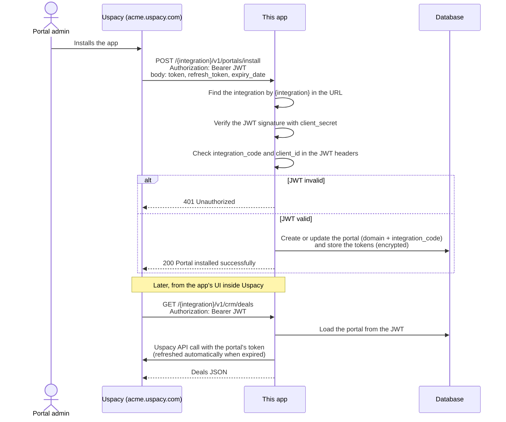

# Uspacy App Template (Laravel)

A starter backend for building an app for the [Uspacy](https://uspacy.com) CRM. It already does the parts every app needs:

- **Install and uninstall.** It keeps a record for each Uspacy portal that installs your app.
- **Calling the Uspacy API.** It calls the API on behalf of a portal and refreshes the access token automatically.
- **Webhooks.** It receives Uspacy events through an AWS SNS subscription.

Requires PHP 8.4 and Composer.

## How it works

1. **Install.** When a portal admin installs your app, Uspacy calls `POST /{integration}/v1/portals/install`. The request carries a JWT signed with your `client_secret` and the portal's API tokens. The app checks the JWT and saves the portal along with its tokens.
2. **Use.** Your app's UI inside Uspacy calls this backend with a JWT. The app finds the portal from the JWT and calls the Uspacy API on its behalf, refreshing the token when it expires.
3. **Events (optional).** If your app subscribes to webhooks, Uspacy sends events through AWS SNS to `POST /{integration}/v1/uspacy/webhooks`. See [Webhooks](#webhooks).
4. **Uninstall.** Uspacy calls `DELETE /{integration}/v1/portals/uninstall`, and the app deletes the portal.



## Quick start

```bash
composer setup        # installs dependencies, creates .env, generates the app key and runs migrations
php artisan serve     # http://localhost:8000
```

You can't register an app in Uspacy yourself: you ask the Uspacy team to do it. They set up the app on their side and send you its credentials. Put them in `.env`:

```dotenv
USPACY_EXAMPLE_INTEGRATION_CODE=example
USPACY_EXAMPLE_CLIENT_ID=...
USPACY_EXAMPLE_CLIENT_SECRET=...
```

Uspacy must be able to reach the server, so it needs a public HTTPS URL. For local testing, use a tunnel such as ngrok or Cloudflare Tunnel.

## Endpoints

Every URL starts with the integration key, then the API version:

| Method | URL | Called by | Purpose | Required |
|---|---|---|---|---|
| `POST` | `/{integration}/v1/portals/install` | Uspacy | App installed on a portal | **Yes** |
| `DELETE` | `/{integration}/v1/portals/uninstall` | Uspacy | App removed from a portal | **Yes** |
| `GET` | `/{integration}/v1/portals/me` | Your frontend | The current portal | No |
| `GET` | `/{integration}/v1/crm/deals` | Your frontend | Example: first 10 CRM deals of the portal | No, example |
| `POST` | `/{integration}/v1/uspacy/webhooks` | AWS SNS | Example webhook receiver (logs messages only) | No, example |

Uspacy needs only `install` and `uninstall`. The CRM deals and webhook routes are examples: replace them with your own app's logic, or delete them.

`{integration}` is a key in [config/uspacy.php](config/uspacy.php), for example `example-integration`. When you ask Uspacy to register your app, send them URLs like these:

```
https://your-server.com/example-integration/v1/portals/install
https://your-server.com/example-integration/v1/portals/uninstall
https://your-server.com/example-integration/v1/uspacy/webhooks
```

## Webhooks

Your app gets webhooks only after it is subscribed to them. You can't subscribe from the app or through an API: you ask the Uspacy team, and they set up the subscription by hand on their side. Ask for each type you need separately. The types are:

- `crm`
- `tasks`
- `messenger`
- `news_feed`

The example webhook route works for `example-integration` only (`whereIn('integration', [...])` in [routes/api.php](routes/api.php)). This is on purpose: one backend can serve several integrations, and some of them may not receive webhooks at all. To turn webhooks on for another integration, add its key to that list.

## Adding another integration

One deployment can serve several Uspacy apps:

1. Add an entry to `integrations` in [config/uspacy.php](config/uspacy.php). Its key becomes the `{integration}` part of the URL.
2. Add its `*_INTEGRATION_CODE`, `*_CLIENT_ID` and `*_CLIENT_SECRET` to `.env`.
3. Put its routes in [routes/api.php](routes/api.php) and its controllers under `App\Http\Controllers\<YourIntegration>`.

## Development

```bash
composer test                # run the tests
vendor/bin/pint --dirty      # format the code
```

